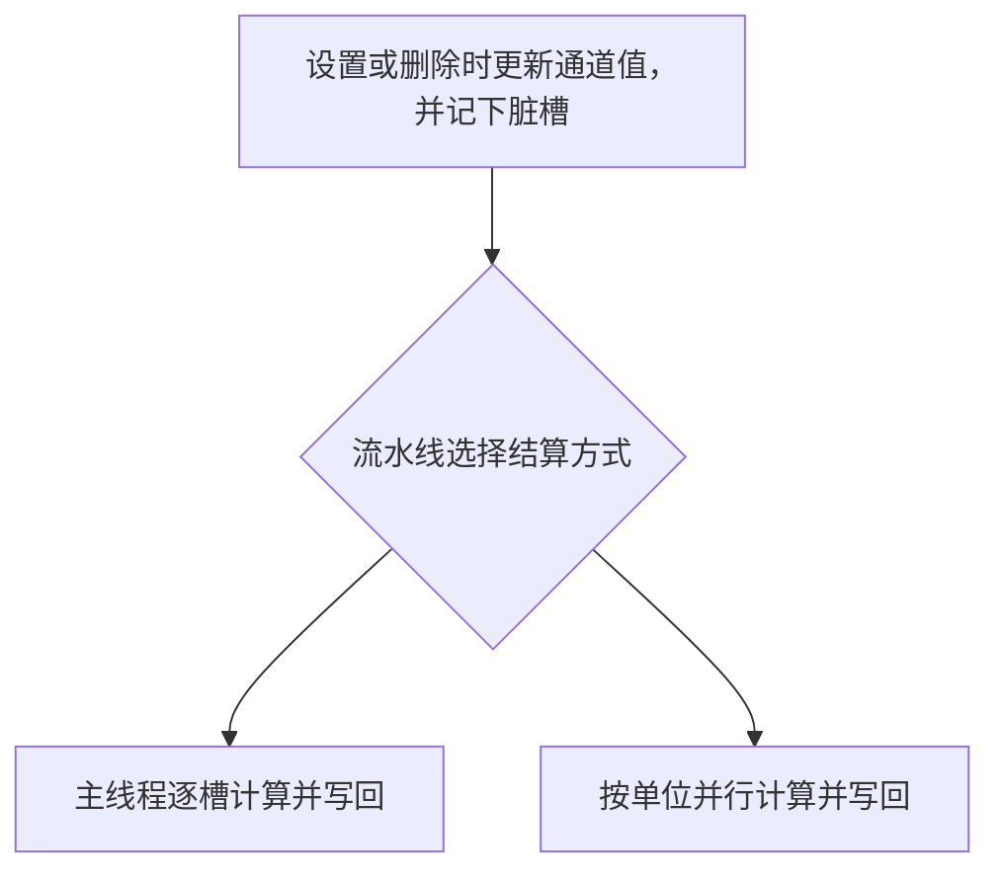

# 属性修改器

属性修改器保存每个 Buff 实例对单位属性各通道的贡献。下一次属性批次把这些贡献结算成基础值和最终值。

数据布局和批次实现见 [属性修改器设计](属性修改器设计.md)。

## 工作流程

属性修改按 Access → Resolve 推进。Access 在主线程上设置、查询和删除贡献，发生在两次批次之间。设置和删除当时就更新通道合计和重载堆顶。Resolve 在属性批次中按脏列表读取这些通道值，计算基础值和最终值，并写回属性。

流水线为 Resolve 准备了两种执行方式：

- 主线程按脏列表逐槽结算。
- 按单位并行结算。主线程先把同一单位的脏槽排到一起，每个作业项处理一个单位。该单位的多个属性在这个作业项里顺序完成。

当前流水线固定选择主线程结算。按单位并行的启用条件留到真机测试之后再写入。



两种方式读到的通道值和写回规则相同。批次开始结算之后的新设置留到下一次批次。

## 通道

每个属性有七个通道。加值和重载使用属性的原始值。百分比使用 Q32.32，与属性本身是整数还是定点数无关。

| 通道 | 值 | 作用 |
| --- | --- | --- |
| `BaseOverride` | 0 | 基础阶段的重载。存在贡献时，基础阶段取权重最高的一条。 |
| `BaseAdd` | 1 | 基础阶段的加值。 |
| `BasePercent` | 2 | 基础阶段的百分比。 |
| `ExtraOverride` | 3 | 额外阶段的重载。存在贡献时，额外阶段取权重最高的一条。 |
| `ExtraAdd` | 4 | 额外阶段的加值。 |
| `ExtraPercent` | 5 | 额外阶段的百分比。 |
| `FinalOverride` | 6 | 最终重载。存在贡献时，属性结果取权重最高的一条。 |

同一 Buff 实例、同一属性、同一通道只保留一条贡献。再次设置时，修改器自己用新值替换旧贡献。调用方不要先删除再写入，也不要把两次设置理解成相加。

要在原贡献上修改，先查询修改器保存的值，在这个值上计算，再设置回去。设置回去仍然是替换，由修改器完成。

```csharp
// 额外加值写成 5。
AttributeAccess.TrySetModifier(
    entityManager,
    unit,
    attackId,
    buffInstanceId,
    AttributeModifierChannel.ExtraAdd,
    valueBits: 5);

// 同一 Buff、同一属性、同一通道再写成 8。
// 修改器替换原贡献。保存的值是 8，不是 5 + 8。
AttributeAccess.TrySetModifier(
    entityManager,
    unit,
    attackId,
    buffInstanceId,
    AttributeModifierChannel.ExtraAdd,
    valueBits: 8);

// 在修改器已保存的 8 上再加 3，然后写回。写回后保存的值是 11。
if (AttributeAccess.TryGetModifierContribution(
        entityManager,
        unit,
        buffInstanceId,
        attackId,
        AttributeModifierChannel.ExtraAdd,
        out long current,
        out _))
{
    AttributeAccess.TrySetModifier(
        entityManager,
        unit,
        attackId,
        buffInstanceId,
        AttributeModifierChannel.ExtraAdd,
        valueBits: current + 3);
}
```

## 计算公式

配置基础值来自属性布局中的默认值。结算分三个阶段。

1. 基础阶段从配置基础值开始。
2. 额外阶段从基础阶段的结果开始。
3. 存在最终重载时，结果改为最终重载。否则结果是额外阶段的结果。

某一阶段存在重载时，该阶段的加值和百分比不参与计算。最终重载替换整个结果。

没有重载的阶段先合计加值，再合计百分比，然后做一次乘法：

- 定点属性：`(起点 + 加值合计) × (1 + 百分比合计)`。
- 整数属性：先对起点和加值合计做饱和加法，再把百分比合计转成 Q32.32 系数，做一次舍入乘除。

合计与写入顺序无关。超出值类型范围时，饱和发生在阶段结果上。

属性要求非负时，每个阶段的结果不得小于 0。结果再按属性的值类型归一化。

### 示例

攻击的配置基础值是 10。

| 贡献 | 结果 |
| --- | --- |
| 一个 Buff 的 `ExtraAdd` 为 5，`ExtraPercent` 为 0.2 | `(10 + 5) × 1.2 = 18` |
| 三个 Buff 的 `ExtraPercent` 各为 0.2 | `10 × (1 + 0.6) = 16` |
| 同一额外阶段同时有加值、百分比和 `ExtraOverride` 10 | 额外阶段结果为 10 |

三个百分比必须来自三个 Buff 实例。同一个 Buff 再写一次额外百分比时，修改器用新百分比替换旧百分比。

## 重载

重载通道按权重选择生效值。权重更大者生效。权重相同则 Buff 实例 ID 更大者生效。加值和百分比不使用权重，保存的权重为 0。

删除该通道的最后一条重载后，该阶段恢复为加值和百分比计算。

## 对属性值的影响

| 行为 | 修改器结果 | 写回 |
| --- | --- | --- |
| 资源 | 最终值是新的最大值。小于 0 时写成 0。 | 更新基础值和最大值，并按下列规则调整当前值。 |
| 数值 | 最终值是新的当前值。 | 更新基础值和当前值。 |
| 标记 | 最终值是新的当前值。 | 与数值属性相同。只接受三个重载通道。 |

资源配置为当前值随最大值缩放，且旧最大值大于 0 时，当前值按 `旧当前值 × 新最大值 / 旧最大值` 缩放。定点缩放无法表示结果时，取该定点数的最大值。旧最大值为 0 时不缩放。无论是否缩放，当前值最后都限制在 0 到新最大值之间。

## 接口

下列方法在主线程、两次 `AttributePipeline.UpdateOnce` 之间调用。单位必须已经执行 `AttributeAccess.InitializeUnit`。

### TrySetModifier

```csharp
bool AttributeAccess.TrySetModifier(
    EntityManager entityManager,
    Entity entity,
    AttributeId attributeId,
    long buffInstanceId,
    AttributeModifierChannel channel,
    long valueBits,
    int weight = 0)
```

写入一条贡献。成功时返回 `true`。下列情况返回 `false`，并且不修改数据：

- Buff 实例 ID 小于或等于 0。
- 通道不是上表中的七个值。
- 单位没有该属性，或尚未初始化修改器。
- 标记属性使用了加值或百分比通道。
- 加值或重载不是该属性值类型的合法原始值。百分比接受任意 `long`。

值和权重都没有变化时返回 `true`。该属性不会因此进入下一次重算。

### TryGetModifierContribution

```csharp
bool AttributeAccess.TryGetModifierContribution(
    EntityManager entityManager,
    Entity entity,
    long buffInstanceId,
    AttributeId attributeId,
    AttributeModifierChannel channel,
    out long valueBits,
    out int weight)
```

返回这条贡献的当前值和权重。读取的是已经保存的贡献，不等待下一次 `UpdateOnce`。不存在该贡献时返回 `false`。

### TryRemoveModifiersByBuff

```csharp
bool AttributeAccess.TryRemoveModifiersByBuff(
    EntityManager entityManager,
    Entity entity,
    long buffInstanceId)
```

立即删除该 Buff 实例在这个单位上的全部贡献。至少删除一条时返回 `true`。属性值在随后一次批次中更新。

## Buff 效果

Buff 效果用当前 Buff 实例调用 `BuffEffectContext.TrySetModifier`。效果配置提供属性、通道、贡献值和重载权重。配置里的操作类型和修改器本地编号不参与结算。同一 Buff 再次执行该效果时，仍由修改器替换原贡献。

瞬时 Buff 可以登记修改器。Buff 销毁发生在属性批次之后，因此这次销毁造成的删除进入下一次属性批次。瞬时 Buff 的修改器影响当前这次批次，并在下一次批次中移除。

## 生效时间

`TrySetModifier` 返回后，`TryGetModifierContribution` 立刻读到新贡献。属性的当前值和最大值要到随后一次 `UpdateOnce` 才改变。

批次已经开始结算之后的新设置，留到下一次批次。事件消费期间提交的修改器因此在下一次 `UpdateOnce` 生效。

## 另请参阅

- [属性修改器设计](属性修改器设计.md)
